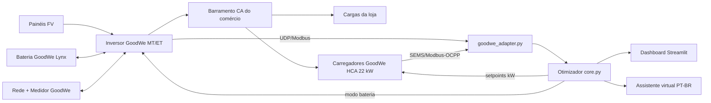
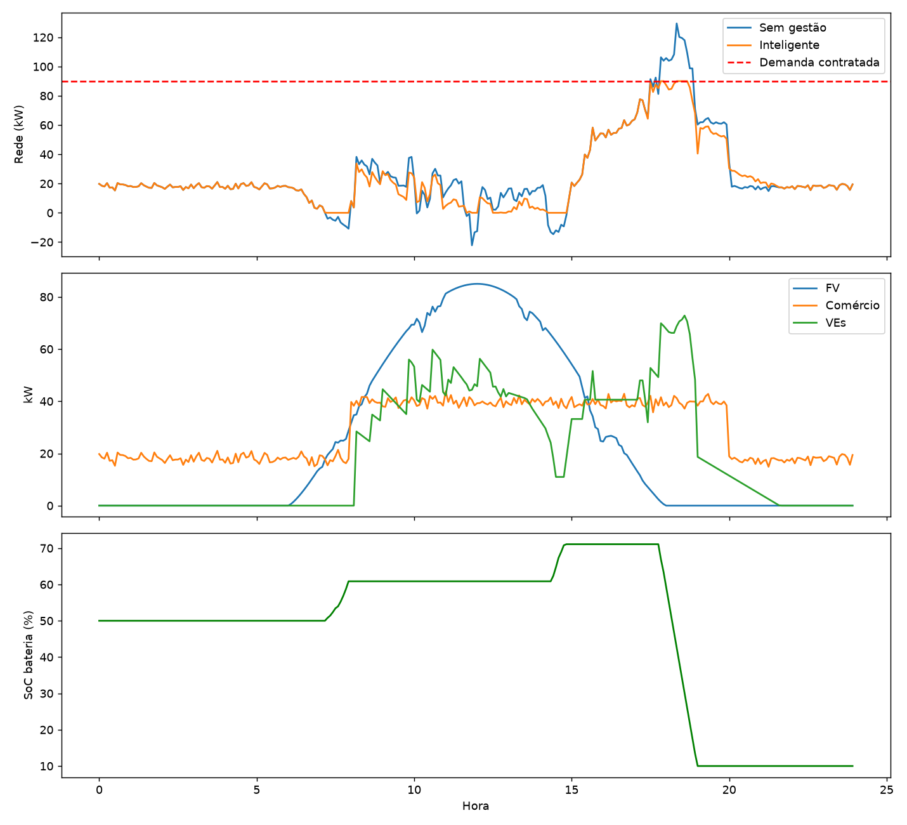

# ⚡ GoodWe EV Commerce Hub — Recarga inteligente de veículos elétricos para comércio

> Sprint 4 – Solução Final Integrada e Inovadora GoodWe

## Equipe
| Nome                  | RM     |
|-----------------------|--------|
| João Victor Montalvão | 571630 |
| Beatriz Araújo        | 570619 |
| Gabriela Caetano      | 572738 |
| Laura Picari          | 569914 |
| Lucas Neves           | 572679 |

🎥 Vídeo (YouTube não listado): _link_

## 1. Problema e solução
Estacionamentos de shoppings, supermercados e redes de varejo enfrentam: (i) picos de demanda que elevam a conta, (ii) tarifa cara no horário de ponta, (iii) energia solar ociosa no meio do dia e (iv) pressão por metas ESG. O **EV Commerce Hub** é um gêmeo digital em **Python** de um hub com **FV + bateria + carregadores AC** GoodWe, com um **otimizador** que coordena tudo em tempo real, **dashboard** e **assistente virtual**.

## 2. Arquitetura

| Módulo | Função |
|---|---|
| `src/core.py` | Gêmeo digital (FV, carga, VEs, bateria), políticas e métricas |
| `src/goodwe_adapter.py` | Leitura real de inversores via biblioteca `goodwe`; classe do carregador HCA; fallback simulado |
| `src/dashboard.py` | Interface web (Streamlit) com KPIs, gráficos e chat |
| `src/assistant.py` | Assistente por intenções (extensível a Alexa/Google via webhook) |
| `src/run_simulation.py` | Gera CSVs, gráfico e tabela de resultados |

## 3. Algoritmo inteligente
1. **Just-in-time (menor folga):** cada VE recebe só a potência necessária para atingir 80% até o horário de saída com folga de 2x (`2 × energia restante / tempo restante`), liberando a vaga cedo e achatando a curva de carga.
2. **Prioridade solar:** excedente FV (FV − carga do comércio) reforça a recarga dos VEs e carrega a bateria.
3. **Peak shaving:** no horário de ponta (18–21h) a bateria cobre a importação da rede.
4. **Gerenciamento de demanda:** se a rede exceder a demanda contratada, a potência dos VEs é reduzida proporcionalmente.

## 4. Alinhamento ao desafio GoodWe e à disciplina
- **Geração, armazenamento e uso** integrados: inversor FV + bateria Lynx + carregadores HCA GoodWe.
- **Monitoramento inteligente:** dados lidos via protocolo do inversor (biblioteca `goodwe`) e painel em tempo real; equivalente ao SEMS Portal.
- **Sustentabilidade:** mais energia solar nos VEs, menos CO₂ e menos pico (ODS 7, 11 e 13).
- **Conteúdos da disciplina:** programação Python, modelagem/simulação, IoT (UDP/Modbus), algoritmos de otimização, visualização de dados, interface conversacional.

## 5. Resultados (simulação de 1 dia, 5 min/passo, semente 7)
<!--R-->
| Métrica | Sem gestão | Inteligente |
|---|---|---|
| ev_kwh | 522.2 | 492.1 |
| ev_solar_pct | 38.5 | 42.3 |
| pico_rede_kw | 129.4 | 90.0 |
| custo_energia_rs | 605.79 | 545.05 |
| receita_rs | 1148.82 | 1082.72 |
| margem_rs | 543.03 | 537.67 |
| autoconsumo_fv_pct | 97.3 | 100.0 |
| import_pico_kwh | 188.0 | 165.1 |
| co2_evitado_kg | 542.5 | 512.0 |
| nao_atendido_kwh | 127.6 | 120.7 |
| veiculos_atendidos | 24 | 22 |
| veiculos_perdidos | 2 | 4 |
<!--/R-->



## 6. Avaliação crítica
**Benefícios:** menor pico de demanda, menor custo de energia, maior uso de FV, CO₂ evitado mensurável.
**Limitações (honestidade técnica):** os dados são **simulados**; tarifas, fator de emissão (0,0385 kg/kWh), perfis de carga e modelos de equipamentos são **premissas configuráveis** em `Cfg` e devem ser validadas com dados reais e datasheets GoodWe. O envio de setpoints ao HCA depende do protocolo/API habilitado no equipamento (SEMS/OCPP); aqui está modelado em `ChargerHCA`. Não há previsão de FV por IA nem V2G.
**Próximos passos:** previsão meteorológica, OCPP real, integração Alexa/Google, tarifa dinâmica.

## 7. Como executar
```bash
pip install -r requirements.txt
python src/run_simulation.py         # gera resultados e atualiza este README
streamlit run src/dashboard.py       # dashboard + assistente
pytest -q                            # testes
# Opcional (inversor real na rede local): goodwe_adapter.read(host="192.168.x.x")
```

## 9. Referências
GoodWe (inversores, Lynx, HCA, SEMS Portal) · biblioteca `goodwe` (marcelblijleven) · Streamlit · pandas/numpy/matplotlib · MCTI (fator de emissão do SIN).
